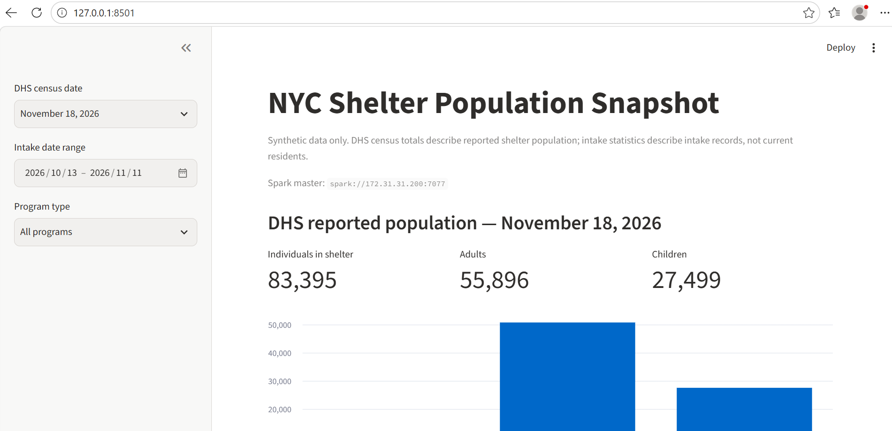
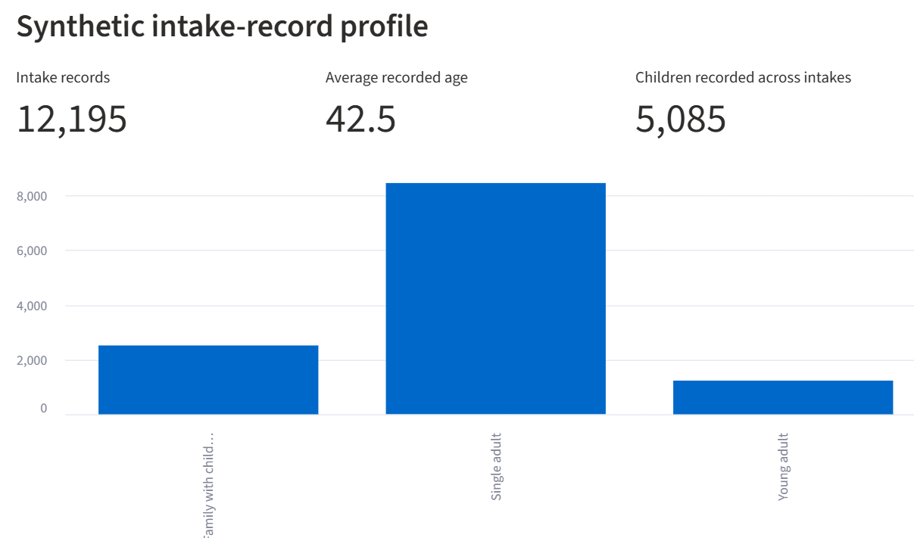

# DSAN6000 Big Data & Cloud Computing: Final Project
### Authors: Erin Brzusek and Jackson Howes

## Abstract 

New York City is one of the most recognizable cities in the world. The glitz and glamor of broadway theatres, the appeal of the incredible restaurant scene, and mindbending skyscrapers are contrasted with the likes of a homeless and housing insecure population not seen since the Great Depression:

> “In recent years, homelessness in New York City has reached the highest level since the Great Depression of the 1930s.” (via. *coalitionforthehomeless.org*)

Currently, New York City publishes ‘Stats & Reports’ on its over three-hundred homeless shelters to a public webpage daily. Unfortunately, these figures are static .pdfs that are overwritten daily and not conducive to modern data science techniques. The data is also scattered across multiple different reports, one describes ‘Pets Whose Owners Enter Homeless Shelters’ while another details ‘Encampment Cleanups and Aided Removals’. 

This project aims to create an interactive dashboard to house all of the data pertaining to the homeless population in the city. The mains tasks are to: 

- Preserve daily reports
- Capture historical trends
- Predict/forecast future needs
- Allow for the application of more modern analytical tools
- Simplify outputs for nontechnical audiences 


## Data Dashboard

The Streamlit dashboard separates the NYC DHS daily census totals from statistics
calculated over the synthetic intake records.

For the selected census date, the DHS section shows:

- totals with their change from the previous day;
- **alerts** for unusual day-over-day changes, meaning 3 or more standard
  deviations from the average daily change over the previous 90 days (about 1%
  of days per series in the 2021–2026 history);
- a breakdown of who is in shelter (single men and women, adults and children
  in families, adult families);
- household-group trendlines, daily over the last 12 months or as monthly
  averages since 2021.

Every chart has hover tooltips and a table view. A warning appears if the
newest census is more than 4 days old, which usually means the daily ingest
job has stopped. The calculations live in `census.py`; run their tests with
`uv run pytest`.



Intake records do not indicate
whether a person is currently in shelter, so their counts and age/children
statistics are labeled as intake-record measures rather than current occupancy.



## Python Environment (uv)

Dependencies are managed with [uv](https://docs.astral.sh/uv/) and pinned in
`uv.lock`. Spark itself needs Java 17 or newer on every node, and the PyPI
`pyspark` version (4.3.0) must match the Spark install in `~/spark`.

Install uv once on the Spark master:

```bash
curl -LsSf https://astral.sh/uv/install.sh | sh
```

From the repository root, create `.venv` with the pinned Python (3.14) and
all dependencies, including the notebook tools:

```bash
uv sync
```

Run commands inside the environment with `uv run` (no activation needed). For
the EDA notebook, select the `.venv` kernel (`.venv/bin/python`) in VS Code or
Jupyter. After pulling changes that touch `pyproject.toml` or `uv.lock`, run
`uv sync` again.

## Building the Curated Intake Tables

The dashboard reads the intake records from curated Parquet tables rather than
the 4 GB source CSV. Build them once (and again whenever the source CSV
changes) on the Spark master. This step needs the AWS credentials described in
[AWS S3 Bucket](#aws-s3-bucket) because it writes to the bucket:

```bash
export SPARK_MASTER_URL="spark://<MASTER_PRIVATE_IP>:7077"
uv run python etl/intake_to_parquet.py
```

This writes `s3a://dsan6000-nyc-dashboard-data/curated/intakes/` (used by the
dashboard) and `curated/intake_details/` (notes and photos), both partitioned
by `intake_month`, and checks the row counts against the source.

## Ingesting the DHS Daily Report

`etl/dhs_daily_ingest.py` pulls the full DHS Daily Report history (about
2,100 rows, one per day since March 2021) from the NYC Open Data API
(`k46n-sa2m`). It needs the same AWS credentials as above:

```bash
export SPARK_MASTER_URL="spark://<MASTER_PRIVATE_IP>:7077"
uv run python etl/dhs_daily_ingest.py
```

Each run writes the API response as fetched to
`raw/dhs_daily/fetched_date=YYYY-MM-DD/` (CSV, so every day's report is
preserved) and rewrites `curated/dhs_daily/` (typed Parquet, used by the
dashboard). It refuses to write if any value fails to parse or a census date
repeats. Because every run re-fetches the whole history, a missed day is
filled in by the next run.

To run it every morning while the lab is up, add a cron entry on the master
(`crontab -e`). Cron starts with a minimal environment, so use absolute paths
and set the master URL in the line itself:

```cron
0 9 * * * cd $HOME/DSAN6000 && SPARK_MASTER_URL=spark://<MASTER_PRIVATE_IP>:7077 $HOME/.local/bin/uv run python etl/dhs_daily_ingest.py >> $HOME/dhs_daily_ingest.log 2>&1
```

AWS Academy credentials expire when the lab session ends, so paste the new
AWS Details block into `~/.aws/credentials` at the start of each session.
Runs with expired credentials fail at the S3 write and leave the bucket
unchanged.

## Running the Dashboard

Set the Spark standalone master URL and start the dashboard:

```bash
export SPARK_MASTER_URL="spark://<MASTER_PRIVATE_IP>:7077"
uv run streamlit run dashboard.py --server.address 127.0.0.1 --server.port 8501
```

The dashboard reads the two curated tables built above and shows which ETL
job to run if one is missing. Set `DHS_DAILY_PATH` or `INTAKE_PARQUET_PATH`
to read them from somewhere other than `curated/dhs_daily/` and
`curated/intakes/`.

Open port 8501 through VS Code's port forwarding or an SSH tunnel; do not expose
the dashboard port publicly. `SPARK_MASTER_URL` defaults to `local[*]` if it is
not set. The dashboard reads the public S3 objects anonymously and caches the
daily report and the aggregated intake results for one hour.


## AWS S3 Bucket

In AWS Academy, open the lab’s AWS Details and copy its AWS CLI credentials/export block into the master terminal. 

On the master node terminal, open the credentials file:

First time:
```
mkdir -p ~/.aws
nano ~/.aws/credentials
```

Otherwise:
```
nano ~/.aws/credentials
```

In nano, paste the entire AWS Details block, including [default]:

```
[default]
aws_access_key_id = YOUR_ACCESS_KEY_ID
aws_secret_access_key = YOUR_SECRET_ACCESS_KEY
aws_session_token = YOUR_SESSION_TOKEN
```

Save with Ctrl+O, Enter, then exit with Ctrl+X. Keep the session token line if AWS Details provided one; temporary Academy credentials need it.

Then secure the file:

```
chmod 600 ~/.aws/credentials
```

Verify the credentials without printing them:

```
aws sts get-caller-identity
```

If that works, try an upload:
```
aws s3 cp \
  s3://dsan6000-final/nyc-shelters/intake_log.csv \
  s3://dsan6000-nyc-dashboard-data/source/nyc-shelters/intake_log.csv \
  --copy-props metadata-directive
```

**Public S3 Bucket Name: dsan6000-nyc-dashboard-data**

```
aws s3 ls s3://dsan6000-nyc-dashboard-data/ --recursive --no-sign-request
2026-11-20 16:31:18     221363 DHS_Daily_Report_20261120.csv
2026-11-20 16:26:36       3565 intakes_codebook.csv
2026-11-20 16:50:43 4055249999 source/nyc-shelters/intake_log.csv
```
